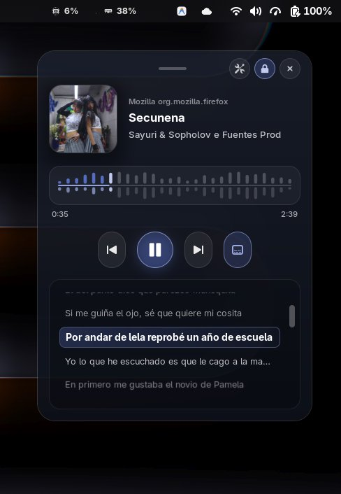

<p align="center">
  
</p>

# Tundra Media Pill v3.2.5

[](https://github.com/TundraLab/Tundra-Media-Pill)
[](https://github.com/GustaHerin)
[](#compatibilidade)
[](#compatibilidade)
[](#compatibilidade)
[](#compatibilidade)
[](#como-instalar)
[](LICENSE)

Produto oficial da **TundraLab**, criado e desenvolvido de forma independente e individual por **Gustavo Henrique Novaes Gomes ([@GustaHerin](https://github.com/GustaHerin))**.

Extensão de mídia para a barra superior do GNOME com controles de reprodução, capa em vinil, letras sincronizadas, waveform personalizável e widget na área de trabalho.

Repositório oficial: https://github.com/TundraLab/Tundra-Media-Pill

---

## Capturas de tela

### Pílula na barra superior


### Menu do player, widget na área de trabalho e configurações

| Card no menu com letras sincronizadas | Widget na área de trabalho | Configurações e idiomas |
| :---: | :---: | :---: |
|  |  |  |

---

## O que ela faz

- **Controla qualquer mídia tocando no PC**: funciona com Spotify, YouTube no navegador, VLC, Rhythmbox e outros players via MPRIS2.
- **Clique na capa para ir até o player**: clicar na capa do álbum abre ou foca a janela onde a música está tocando.
- **Letra sincronizada ao vivo**: mostra o verso atual direto na barra superior e acompanha a faixa no painel de letras via LRCLIB (com rolagem automática também para letras sem timestamp).
- **10 estilos de waveform e 7 estilos na pílula**: barras clássicas, reflexo SoundCloud, equalizador LED, partículas, slider, matriz retrô, osciloscópio, fita de pulso, batimento ECG e trilho estéreo.
- **Paleta com 13 cores ou cor da capa**: escolha uma cor de destaque fixa ou extraia automaticamente da capa do álbum.
- **Widget na área de trabalho**: fixe o card completo no papel de parede ou sempre visível acima das janelas, com opção de arrastar e travar posição.
- **Português e English**: selecione o idioma direto nas configurações ou siga o idioma do sistema.

---

## Compatibilidade

- **GNOME 47, 48, 49, 50 e 51** (Fedora Workstation, Pop!_OS, Ubuntu, Arch Linux e demais distribuições com GNOME).
- Suporte completo a **Wayland** e **X11**.

---

## Como instalar

### 1. Instalar dependências (Linux recém-instalado)

Em instalações novas de Linux, ferramentas como `curl`, `glib-compile-schemas` e bibliotecas do GNOME (`GTK4`, `Libadwaita`, `libsoup 3`) podem não vir instaladas por padrão. Rode o comando da sua distribuição antes de instalar:

**Ubuntu / Pop!_OS / Debian:**
```bash
sudo apt update && sudo apt install -y curl git tar libglib2.0-bin gir1.2-soup-3.0 gir1.2-gtk-4.0 gir1.2-adw-1 gir1.2-gdkpixbuf-2.0 gnome-shell-extension-prefs
```

**Fedora Workstation:**
```bash
sudo dnf install -y curl git tar glib2-devel libsoup3 gtk4 libadwaita gdk-pixbuf2 gnome-extensions-app
```

**Arch Linux / Manjaro / EndeavourOS:**
```bash
sudo pacman -S --needed curl git tar glib2 libsoup3 gtk4 libadwaita gdk-pixbuf2 gnome-shell
```

**openSUSE:**
```bash
sudo zypper install -y curl git tar glib2-tools typelib-1_0-Soup-3_0 typelib-1_0-Gtk-4_0 typelib-1_0-Adw-1 typelib-1_0-GdkPixbuf-2_0
```

> Se faltar alguma dependência ao executar o instalador, o próprio `install.sh` detecta o que está ausente e pergunta se você quer instalar via `sudo` (ou use `--yes` para instalar direto).

### 2. Instalar a extensão via terminal (recomendado)

Execute o comando abaixo no terminal para baixar, compilar o esquema e instalar a extensão automaticamente:

```bash
curl -fsSL https://raw.githubusercontent.com/TundraLab/Tundra-Media-Pill/main/install.sh | bash
```

> **Para desinstalar:**
> ```bash
> curl -fsSL https://raw.githubusercontent.com/TundraLab/Tundra-Media-Pill/main/install.sh | bash -s -- --uninstall
> ```

### Instalação manual pelo código-fonte

```bash
git clone https://github.com/TundraLab/Tundra-Media-Pill.git
cd Tundra-Media-Pill
chmod +x install.sh
./install.sh --copy
```

Após instalar, **reinicie a sessão** (faça logout e entre novamente no sistema; no X11, pressione `Alt + F2`, digite `r` e aperte `Enter`).

Pronto! A extensão já ficará ativada e configurada para iniciar sozinha sempre que você ligar o Linux.

---

## Como usar e configurar

- **Na barra superior**: clique na pílula quando estiver ouvindo algo para abrir o player completo, controlar a reprodução e ver a letra.
- **Na área de trabalho**: clique no ícone de pino dentro do menu do player para fixar ou remover o widget da área de trabalho. Você pode arrastá-lo pela tela ou travar a posição pelo cadeado.
- **Configurações**: abra o aplicativo **Extensões** do GNOME e clique na engrenagem ao lado de **Tundra Media Pill** (ou no botão de configurações dentro do próprio player).

---

## Licença e Propriedade Intelectual

**Todos os Direitos Reservados (`All Rights Reserved`)**  
Copyright © 2026 **TundraLab** e **Gustavo Henrique Novaes Gomes** ([@GustaHerin](https://github.com/GustaHerin)).

Produto proprietário da **TundraLab**, concebido e desenvolvido de forma independente por seu autor único. Consulte o arquivo [LICENSE](./LICENSE) para mais detalhes. É proibida a cópia, modificação ou redistribuição sem autorização prévia por escrito.
