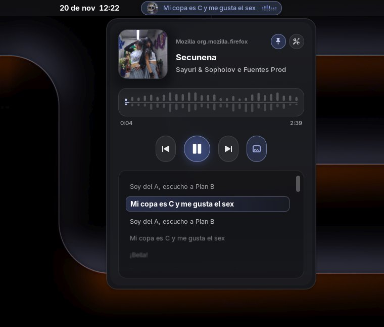
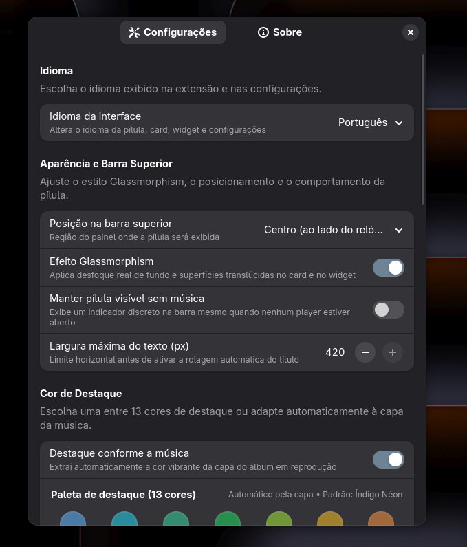

<p align="center">
  
</p>

# Tundra Media Pill

Extensão de mídia para a barra superior do GNOME com controles de reprodução, letras sincronizadas e widget na área de trabalho.

Feito por **TundraLab - Gustavo Henrique Novaes Gomes ([@GustaHerin](https://github.com/GustaHerin))** | [GitHub da TundraLab](https://github.com/TundraLab)

---

## Capturas de tela

### Pílula na barra superior


### Menu do player, widget na área de trabalho e configurações

| Card no menu com letras sincronizadas | Widget na área de trabalho | Configurações e idiomas |
| :---: | :---: | :---: |
|  |  |  |

---

## O que ela faz

- **Controla qualquer mídia tocando no PC**: funciona com Spotify, YouTube no navegador, VLC, Rhythmbox e outros players via MPRIS2.
- **Clique na capa para ir até o player**: clicar na capa do álbum abre ou foca a janela onde a música está tocando.
- **Letra sincronizada ao vivo**: mostra o verso atual direto na barra superior e acompanha a faixa no painel de letras via LRCLIB (com rolagem automática também para letras sem timestamp).
- **10 estilos de waveform e 7 estilos na pílula**: barras clássicas, reflexo SoundCloud, equalizador LED, partículas, slider, matriz retrô, osciloscópio, fita de pulso, batimento ECG e trilho estéreo.
- **Paleta com 13 cores ou cor da capa**: escolha uma cor de destaque fixa ou extraia automaticamente da capa do álbum.
- **Widget na área de trabalho**: fixe o card completo no papel de parede ou sempre visível acima das janelas, com opção de arrastar e travar posição.
- **Português e English**: selecione o idioma direto nas configurações ou siga o idioma do sistema.

---

## Compatibilidade

- **GNOME 47, 48, 49, 50 e 51** (Ubuntu, Fedora, Arch, etc.).

---

## Como instalar

1. Baixe este projeto e abra a pasta no terminal.
2. Execute o instalador:

```bash
chmod +x install.sh
./install.sh
```

3. **Reinicie a sessão** (faça logout e entre novamente no sistema; se usar X11, pode apenas pressionar `Alt + F2`, digitar `r` e apertar `Enter`).

Pronto! A extensão já ficará ativada e configurada para iniciar sozinha sempre que você ligar o Linux.

> **Para desinstalar:** basta rodar `./install.sh --uninstall` na mesma pasta.

---

## Como usar e configurar

- **Na barra superior**: clique na pílula quando estiver ouvindo algo para abrir o player completo, controlar a reprodução e ver a letra.
- **Na área de trabalho**: clique no ícone de pino dentro do menu do player para fixar ou remover o widget da área de trabalho. Você pode arrastá-lo pela tela ou travar a posição pelo cadeado.
- **Configurações**: abra o aplicativo **Extensões** do GNOME e clique na engrenagem ao lado de **Tundra Media Pill** (ou no botão de configurações dentro do próprio player).

---

## Licença

Copyright (c) 2026 **TundraLab - Gustavo Henrique Novaes Gomes (@GustaHerin)**  
Todos os direitos reservados.

Consulte o arquivo [LICENSE](./LICENSE) para mais detalhes. É proibida a cópia, modificação ou redistribuição sem autorização do autor.
